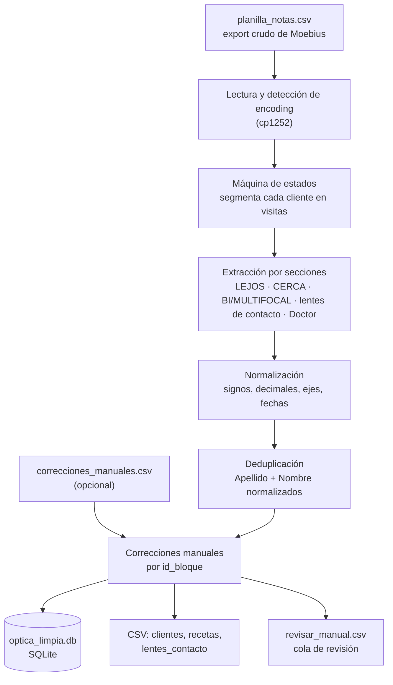

# Rescate del historial de una óptica

ETL en Python que convierte 20 años de recetas atrapadas en un campo de texto libre en una base de datos limpia, deduplicada y auditable.

> Este repositorio usa **datos de ejemplo 100 % inventados**. Los datos reales de la óptica son historias clínicas de pacientes y no salen de la PC donde se procesan.

## El problema

En la **Óptica Morelli**, al migrar al sistema Moebius, el historial de clientes de 20 años quedó atrapado en un solo campo de texto libre: "Notas". Ahí adentro está todo mezclado: recetas de anteojos y de lentes de contacto, modelos, médicos y comentarios del mostrador. Los formatos son inconsistentes, los clientes están duplicados y el documento viene casi siempre en `0`.

Para buscar la última receta de un cliente había que leer ese texto a mano.

## Por qué es difícil

- **El CSV exportado está roto.** El campo Notas es multilínea y va sin comillas. `pandas.read_csv` y cualquier lector estándar lo parten mal, así que el archivo se lee con una máquina de estados, renglón por renglón.
- **Hay dos "dialectos".** El que escribe el sistema (`<< FECHA: dd/mm/aaaa >>`, `LEJOS:`, `O.D.  Esf. -1.25  Cil. +0.50  En 90`) y el tipeado a mano (`OD ESF. - 2.25 CIL. - 0.50 A 165`), sin marcadores de fecha.
- **El dominio tiene trampas:**
  - `Color` no es un color: es el modelo del anteojo.
  - `En 90` es el eje del cilindro.
  - `Doctor:` no siempre es un doctor: miles de veces dice `COPIA ANT.EN USO`.
  - En lentes de contacto conviven la receta del médico, la adaptación del contactólogo y la potencia del lente entregado, y no son lo mismo.
- **Son datos de salud.** Un número mal asignado no es un error de formato: es una graduación falsa que puede terminar en un par de anteojos.

## Cómo funciona



## Decisiones técnicas

| Decisión | Por qué |
|---|---|
| **Idempotencia** | La base es una función pura de la entrada: se borra y se reconstruye entera en cada corrida. Correrlo dos veces da los mismos archivos, byte a byte. |
| **`id_bloque` con SHA-256** | Cada visita se identifica por un hash de su texto y del cliente, no por el número de línea. Es estable entre corridas y entre exports, y sirve de ancla para las correcciones. |
| **Correcciones manuales como entrada aparte** | Lo que se corrige a mano va en `correcciones_manuales.csv`, nunca en la base. Si se vuelve a exportar de Moebius, las correcciones se aplican igual, y cada receta corregida queda marcada `origen = manual`. |
| **Cola de revisión con motivo y severidad** | Todo lo dudoso va a `revisar_manual.csv` con un motivo de un catálogo cerrado y una severidad (alta, media, baja). Así se ve si un problema afecta a miles de registros (falta una regla) o a pocos (se corrige a mano). |
| **"Ante la duda, a revisión, nunca a una columna"** | Si no se sabe con certeza qué es un número, no se asigna por su posición: el renglón va entero a observaciones y a revisión. Nada se inventa ni se descarta en silencio. |
| **Privacidad** | El repositorio de trabajo tiene datos de pacientes y no se publica. Este es una copia del código con datos generados al azar que imitan el formato del original, pero no su contenido. |

## Resultados con los datos reales

Estas cifras salen de una corrida sobre los **datos reales de la óptica, que no están en este repositorio**:

| | |
|---|---:|
| Registros de entrada | 32.194 |
| Clientes únicos | 29.951 |
| Registros duplicados fusionados | 2.243 |
| Recetas (visitas) extraídas | 62.475 |
| Visitas con datos de lentes de contacto | 5.239 |
| Casos para revisión manual | 7.748 |
| Duración de la corrida | ~16 s |

## Cómo correr la demo

**Requisitos:** Python 3.11 o superior. El ETL usa solo la biblioteca estándar; `pytest` hace falta solo para los tests.

```bash
git clone https://github.com/PatricioJacob/etl-historial-optica.git
cd etl-historial-optica
pip install -r requirements.txt
python correr_demo.py
```

El comando genera `datos_ejemplo/` si no existe (unos 200 clientes inventados, con semilla fija), corre el ETL e imprime un resumen. Con `--regenerar` vuelve a generar los datos antes.

**Qué queda en `salida/`:**

| Archivo | Contenido |
|---|---|
| `optica_limpia.db` | Base SQLite con las tablas `clientes` y `recetas` |
| `clientes.csv`, `recetas.csv` | Las mismas tablas, para abrir con Excel |
| `lentes_contacto.csv` | Una fila por prescripción de lentes de contacto |
| `revisar_manual.csv` | La cola de revisión, ordenada por severidad |
| `reporte_calidad.md` | Métricas de la corrida |

**Tests:**

```bash
python -m pytest
```

Para correr el ETL sobre otro archivo: `python etl_optica.py --entrada otra.csv --salida otra_carpeta`.

## Próximos pasos

- Cargar la base en el modelo relacional normalizado que diseñamos en la materia Bases de Datos.
- Una aplicación de escritorio para que el mostrador busque un cliente por apellido y vea su historial.

## Herramientas

- **Python** (biblioteca estándar: `re`, `csv`, `sqlite3`, `hashlib`) y **SQLite**. Tests con `pytest`.
- **Claude Code** como herramienta de asistencia en desarrollo. 

## Autores

**Patricio Jacob Cruz** y **Juan Cruz Dellaghelfa**, estudiantes de la Licenciatura en Ciencia de Datos de la Facultad de Ingeniería de la UNER (FIUNER). El proyecto se hizo en el marco de las prácticas profesionalizantes del Trabajo Integrador.
